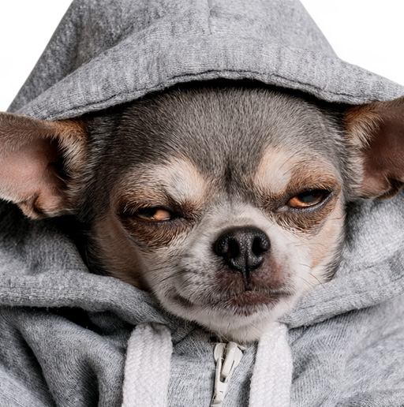
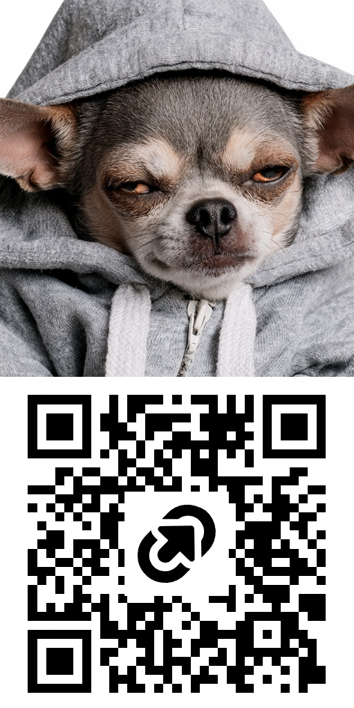

# Lookwider

[English](README.md) | [Русский](README.ru.md)

CTF tool for revealing image data hidden by modified dimensions.
Patches PNG, BMP and JPEG headers without re-encoding pixel data.

**Python 3.9+ · No runtime dependencies**

## Install

From the project directory, with pipx installed:

```bash
pipx install .
```

Or run directly without installing:

```bash
python3 lookwider.py --help
```

## Usage

```bash
# Inspect the header and estimate the full height
lookwider inspect task.png

# Recover PNG/BMP height automatically
lookwider recover task.png -o revealed.png

# Set height and/or width manually
lookwider set task.jpg --height 1024 -o revealed.jpg
lookwider set task.png --width 512 --height 1024 -o revealed.png

# Generate height candidates: START:STOP:STEP (inclusive)
lookwider sweep task.jpg --heights 600:1200:100 -d variants

# Fix PNG IHDR CRC without changing dimensions
lookwider set bad-crc.png -o fixed.png
```

Use `python3 lookwider.py` instead of `lookwider` when running without installation.
`inspect --json` produces a JSON report. `--force` overwrites existing outputs;
the input file is always protected. `--max-mib` sets the input/inflation limit
(default: 256 MiB each).

## Example

The sample JPEG declares **512×516** pixels. Increasing its height reveals a QR code:

```bash
lookwider set docs/images/bigdawg-before.jpg --height 1024 -o revealed.jpg
```

| Before: 512×516 | After: 512×1024 |
| --- | --- |
|  |  |

Only two SOF height bytes change; the JPEG stays **182,090 bytes**.
The result above is a PNG preview.

## Support

| Format | Automatic height | Manual dimensions |
| --- | --- | --- |
| PNG, non-interlaced | Yes, from IDAT rows | Yes, with IHDR CRC repair |
| PNG, Adam7 | No | Yes |
| Uncompressed / bitfield BMP | Candidate from available pixel bytes | Yes |
| JPEG, including progressive | No | Yes, or use `sweep` |

APNG and compressed BMP are not supported for editing. BMP trailing data may
look like extra rows; inspect the result. Oversized JPEG dimensions may cause
decoding artifacts. Recovery requires the hidden data to still exist in the file.

## Tests

```bash
python3 -m unittest discover -s tests -v
```

## License

[MIT](LICENSE). Sample images are user-provided and are not covered by the code license.
